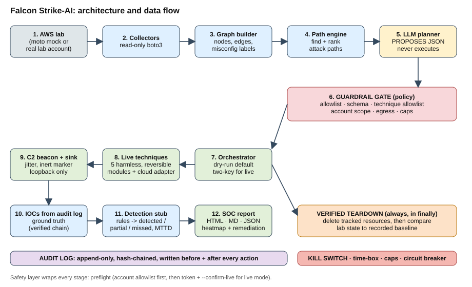

# Architecture

(Export `architecture.svg` to PNG for slides: open in a browser and screenshot, or use any SVG converter.)

## Subsystems
- **Environment mapper** (`collectors/`, `graph/`): read-only boto3 calls -> JSON snapshot -> NetworkX property graph
  (nodes: Internet, Account, Role, User, Endpoint, Instance, Resource; edges: CAN_ASSUME, EXPOSES, BOUND_TO).
  Misconfigurations are node properties (`is_wildcard`, `privesc_primitive`, `is_public`, `is_high_value`).
  Paths are ranked by `impact/hops + 0.5*weak nodes + 2 if internet-reachable`.
- **Agentic orchestrator** (`planner/`, `orchestrator.py`, `live.py`): the planner emits JSON actions only. Output is parsed against a strict
  schema, then every action must pass the guardrail gate. The executor resolves actions to vetted modules; the model has no shell or SDK access.
- **Sandbox / execution** (`techniques/`, `cloud/`, `c2/`): each technique is a contract (ATT&CK ID, preconditions, emulated action, expected IOCs,
  teardown, `destructive` which can never be true). Live modules go through a minimal cloud adapter (Fake or boto3).
- **Telemetry and detection** (`audit/`, `detection/`, `report/`): ground-truth IOCs are reconstructed from the verified audit log; a detection stub
  (rule files) decides detected / partial / missed and simulated time-to-detect; the report generator writes JSON, HTML and Markdown.

## Interfaces
Typed, versioned JSON between stages: snapshot -> graph -> ranked paths -> planner JSON `{"actions":[{technique_id, params, rationale}]}` ->
guardrail-approved plan -> audit records (`docs/audit_log_schema.json`) -> report JSON (`falcon-report/1.0`).

## Design principles
Safety enforced in code, not policy; model plans, code executes; record-before-act for teardown; deterministic seeds for replay;
add a technique without touching the orchestrator; adapter interface so Azure/GCP can be added later.
